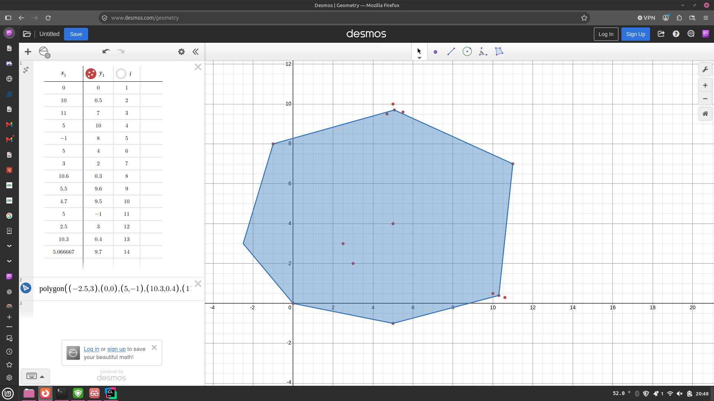
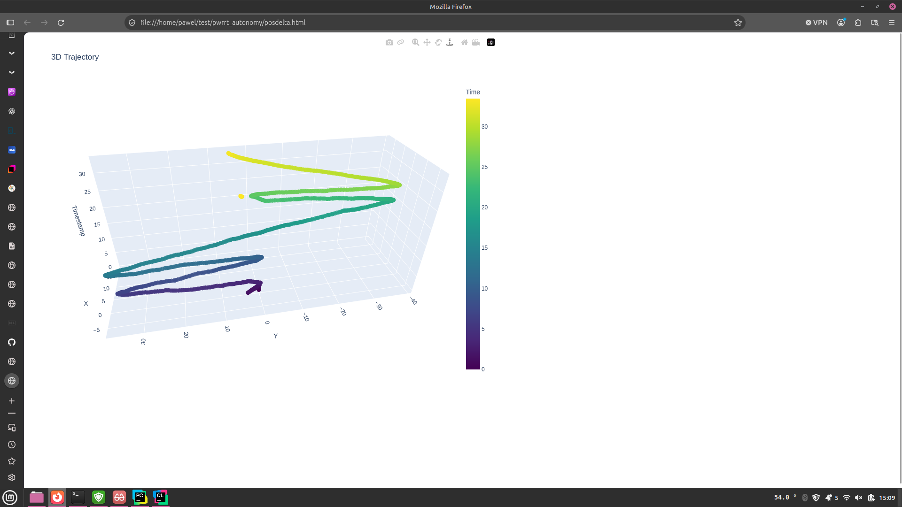

# To run the program for task 1.1 and 1.2 (on Linux)
1. Clone the repository
2. Navigate to the directory <br>
3. To compile the program run
```bash
cmake -S . -B build -G "Unix Makefiles" &&
cmake --build build
```
`Warning! C++20 is required to compile these programs!`

4. Navigate to `build`

Or one line:
```bash
git clone https://github.com/wegorz9/pwrrt_autonomy.git &&
cd pwrrt_autonomy &&
cmake -S . -B build -G "Unix Makefiles" &&
cmake --build build
```

5. Run the program with
```bash
./build/pwrrt_autonomy example_input.txt
```
## On Windows
[Cmake](https://cmake.org/download/) and [MinGW](https://www.mingw-w64.org/) are required.

To clone the repo and compile the C++ code, run in your PowerShell:
```powershell
git clone https://github.com/wegorz9/pwrrt_autonomy.git
cd pwrrt_autonomy
cmake -S . -B build -G "MinGW Makefiles"
cmake --build build
```


## Solution description
1. Read the file and convert everything from strings to proper values.
2. Create all possible candidates for deduplication
3. Cull those candidates
4. Create new cones and mark the old ones for deletion
5. Merge the lists
6. Create the convex hull using the [monotone chain method](https://www.geeksforgeeks.org/dsa/convex-hull-monotone-chain-algorithm/)
7. Print out the results

## Problems and edgecases encountered
 - In one of the early iterations of the file parsing algorithm, the code used to only work with a debugger connected. 
I believe that the compiler optimized out the file access and printing to console, despite those being "volatile" in C parlance.
 - The deduplication code was the most edgecase ridden part of the program, most prominent of which was a problem with 
the culling. Sometimes the inner loop would not run because of a misplaced IF statement. 


### Solutions provided were checked manually using a graphing calculator
The graph includes the points that were supposed to be deleted. That is why the polygon does not include them.



# Task 2.1 and 2.2

## Task 2.1
After graphing the provided data from both sensors, and the difference of position between them, it became apparent that they are not mounted properly.
In particular they disagree about which way is towards positive Y. Sensor 1 shows a turn to the right circle (as the regulations state), meanwhile Sensor 2 shows a turn to the left circle. To fix this, either, one of the sensors should be flipped around the X axis, or a correction in software can be applied (flipping the sign of the Y reading from Sensor 2).



Visualizations can be made by running:
```bash
python3 main.py
```
It is recommended to create a virtual environment for python before running the script, with:
```bash
python3 -m venv .venv
source .venv/bin/activate
```
`Warning! Packages plotly and matplotlib are required to run the python program. They can be installed with: "pip install plotly" and "pip install matplotlib"`<br>
5 files will be created, sensor1.html, sensor2.html, interpolation1.html, interpolation2.html and posdelta.html. To open them a regular web browser may be used.

```sensor1.html``` visualises data from sensor 1.

```sensor2.html``` visualises data from sensor 2.

```posdelta.html``` visualises data from the difference between sensor 1 and sensor 2. In case there was not a corresponding point at that timestamp in sensor2, interpolation was used to estimate the position.

```interpolation1.html``` visualises data from sensor 1 and showcases the interpolation algorithm for that dataset.

```interpolation2.html``` visualises data from sensor 2 and showcases the interpolation algorithm for that dataset. Since sensor 2 data is much sparser, the interpolated points are easier to see,

## To run the program for task 2.2:
To compile the program follow the steps outlined [here](#to-run-the-program-for-task-11-and-12-on-linux)
1. Navigate to `pwrrt_autonomy/build`
2. Run the program with
```bash
./build/position_interpolator sensor1.csv sensor2.csv
```

## Task 2 solution description

#### Task 2.1
 1. The data from the sensors was visualized, along with the data from the difference between them.
2. In the difference data I noticed very large swings between -30 and 40 on the Y axis.
3. After a closer investigation of the sensor data with the rulebook in hand, I concluded that one of the sensors had y readings flipped in relation to the other sensor.

Matplotlib was initially used, but proved insufficient for the task at hand. The option to use it for generating the graphs still exists, but the interactive plots made by plotly seem to be superior for 3D data.

#### Task 2.2
1. Reading the data from the files
2. Waiting for the user input
3. Interpolating between points of sensor 1 data based on the provided timestamp.

### Problems and edgecases in task 2

 - In the description of task 2, it was not specified how we're supposed to estimate position. I've decided on linear interpolation between datapoints, and the nearest point before the first and last timestamp. I felt that extrapolation was not the right call, since the car either was stationary before the beginning of the race, or it was going to be stationary at the end. Linear interpolation was used because its fast, easy to implement and for dense data quite accurate.